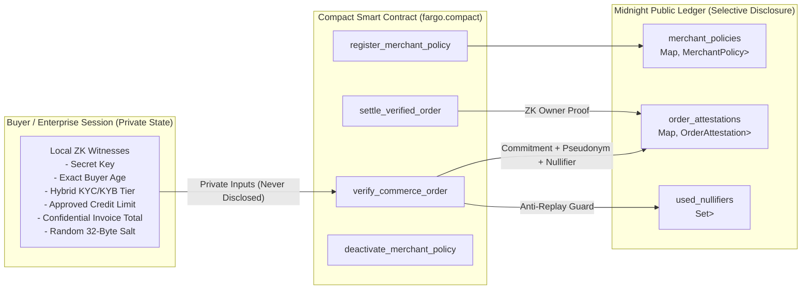

# FARGO — Privacy-Preserving Commerce Infrastructure

> *Verify transactions. Protect business data.*  
> Built on the **Midnight Network** using **Compact** zero-knowledge smart contracts.

[](./LICENSE)
[](https://midnight.network/)
[](https://docs.midnight.network/)

---

## 1. Overview & Problem Statement

Digital commerce and B2B supply chains force businesses and customers into **systematic data over-disclosure**:
- **Retail & Regulated E-Commerce:** Proving age or identity eligibility forces shoppers to hand over raw birthdates and identity documents to dozens of merchant databases.
- **B2B Trade & Net-30 Invoicing:** Proving creditworthiness or solvency requires corporate buyers to expose confidential credit facility balances, revenue figures, and sensitive invoice amounts across third-party platforms and public ledgers.

**FARGO** is a non-intrusive **privacy and verification layer** that plugs into existing e-commerce and B2B commerce platforms via SDK/API. Powered by **Midnight's Dual-Ledger architecture** and **Compact zero-knowledge circuits**, FARGO enables buyers and businesses to prove full compliance with merchant policies without exposing underlying personal or commercial secrets.

---

## 2. Architecture & Midnight Dual-Ledger Model



### Dual-Ledger Separation (Private vs. Public State)

| Attribute | Storage Layer | Visibility | Purpose |
| :--- | :--- | :--- | :--- |
| `local_secret_key` | Local Witness | **Private** | Derives merchant owner PK, buyer pseudonyms, and nullifiers in ZK |
| `private_buyer_age` | Local Witness | **Private** | Proves `age >= policy.min_age` without revealing DOB or exact age |
| `private_kyc_tier` | Local Witness | **Private** | Hybrid Identity check (`tier >= policy.required_kyc_tier`) |
| `private_credit_limit` | Local Witness | **Private** | Proves corporate credit line meets floor & covers order total |
| `private_order_amount` | Local Witness | **Private** | Keeps B2B invoice value confidential from competitors on-chain |
| `buyer_pseudonym` | Midnight Ledger | **Public (Unlinkable)** | `persistentHash("fargo:buyer:v1", sk, merchant_id)` — distinct per merchant |
| `commitment` | Midnight Ledger | **Public** | Salted cryptographic commitment binding order ID, amount, and tier |
| `nullifier` | Midnight Ledger | **Public** | Prevents order replay and double-attestation |

---

## 3. Repository Structure

```text
fargo-midnight/
├── docker/
│   └── compactc.Dockerfile       # Reproducible Linux container pinning compactc 0.30.0
├── packages/
│   ├── contract/                 # @fargo/contract — Compact smart contract & ZK unit tests
│   │   └── src/
│   │       ├── fargo.compact     # Core Midnight Compact contract (4 exported ZK circuits)
│   │       ├── witnesses.ts      # Private state & local witness implementations
│   │       ├── managed/fargo/    # Compiled ZKIR, prover/verifier keys & TypeScript bindings
│   │       └── test/             # Multi-actor Dual-Ledger simulator & 12 Vitest specs
│   └── sdk/                      # @fargo/sdk — Drop-in Commerce Plugin & API client
│       └── src/
│           ├── index.ts          # FargoCommerceClient & Dual-Ledger inspector
│           └── test/             # End-to-end SDK lifecycle & failure-handling tests
└── apps/
    └── web/                      # @fargo/web — Interactive Checkout Plugin & Merchant Console
```

---

## 4. Quick Start (Judge Evaluation Guide)

### Prerequisites
- **Node.js** `>= 20` and **npm** `>= 10`
- *(Optional, only if recompiling `.compact` from source)* **Docker** or **Midnight `compactc 0.30.0`**

> Pre-compiled contract artifacts (`packages/contract/src/managed/fargo`) are included so judges can build, test, and launch the live UI immediately on macOS, Linux, or Windows with zero external setup.

### 1. Install & Build All Workspaces
```bash
npm install
npm run build
```

### 2. Run Simulation & Unit Tests (14 Test Cases)
```bash
npm test
```
This runs:
- **12 Compact contract tests** (`@fargo/contract`): policy registration, ZK owner authentication, unauthorized hijack protection, B2B credit solvency verification, unlinkable per-merchant pseudonyms, commitment hiding, underage/KYC/credit/replay rejections, and merchant settlement.
- **2 SDK integration tests** (`@fargo/sdk`): full commerce lifecycle and structured ZK constraint failure reporting.

### 3. Launch the Interactive Web Application
```bash
npm run dev
```
Open `http://localhost:5173` in your browser to test:
1. **Checkout & Dual-Ledger View:** Run 1-click scenarios (*Valid B2B Net-30*, *Age-Gated Retail*, *Exceed Credit Limit Rejection*), inspect redacted private witnesses alongside live Midnight public ledger commitments, and settle orders as the merchant owner.
2. **Merchant Policy Console:** Publish new merchant compliance policies directly to `ledger.merchant_policies`.
3. **Plugin & API SDK:** Generate drop-in `@fargo/sdk` integration snippets for existing storefronts.

### 4. Recompiling `fargo.compact` from Source (Reproducible Docker Build)
On any OS (including Windows, macOS Intel/ARM, and Linux) with Docker running:
```bash
npm run docker:compactc
npm run compact:docker
```
Or natively on Linux/macOS with `compactc 0.30.0` installed:
```bash
npm run compact
```

---

## 5. Product Roadmap

1. **Phase 1 (Current MVP):** Core `fargo.compact` protocol, Dual-Ledger simulator, `@fargo/sdk` plugin client, and interactive Checkout + Merchant Verification Console.
2. **Phase 2:** Live Midnight Testnet / PreProd proof-server & Lace DApp Connector deployment with webhook callbacks.
3. **Phase 3:** Turnkey Shopify, WooCommerce, and B2B ERP checkout extensions + Hybrid Identity issuer bridges.
4. **Phase 4:** Enterprise pilots across B2B wholesale supply chains and age/compliance-regulated marketplaces.

---

## 6. Ecosystem Attribution & License

Built for the **Midnight Network** ecosystem using [Midnight Compact](https://docs.midnight.network/) (`compactc 0.30.0`) and `@midnight-ntwrk/compact-runtime` (`0.15.0`).

Licensed under the **Apache License, Version 2.0** — see [LICENSE](./LICENSE) for details.
