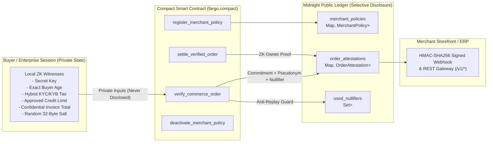

# FARGO — Privacy-Preserving Commerce Infrastructure

> *Verify transactions. Protect business data.*  
> Drop-in zero-knowledge compliance and B2B solvency verification layer built on the **Midnight Network** using **Compact** smart contracts.

[](./LICENSE)
[](https://midnight.network/)
[](https://docs.midnight.network/)
[](#2-run-simulation-qa--gateway-tests-22-test-cases)

---

## 1. Overview & Problem Statement

Digital commerce and B2B supply chains force businesses and customers into **systematic data over-disclosure**:
- **Retail & Regulated E-Commerce:** Proving statutory age or identity eligibility forces shoppers to hand over raw birthdates and identity documents to merchant databases that become high-risk breach targets.
- **B2B Trade & Net-30 Invoicing:** Qualifying for supplier trade credit requires corporate buyers to expose confidential credit facility limits, bank balances, and negotiated invoice amounts across third-party portals or transparent public blockchains.

**FARGO** is a non-intrusive **privacy and verification layer** that integrates into existing e-commerce and B2B platforms via SDK, webhooks, and REST API. Powered by **Midnight's Dual-Ledger architecture** and **Compact zero-knowledge circuits**, FARGO enables buyers and enterprises to prove full compliance with merchant policies without exposing underlying personal or commercial secrets.

---

## 2. Architecture & Midnight Dual-Ledger Model



### Dual-Ledger Separation (Private vs. Public State)

| Attribute | Storage Layer | Visibility | Purpose |
| :--- | :--- | :--- | :--- |
| `local_secret_key` | Local Witness | **Private** | Derives merchant owner PK, buyer pseudonyms, and nullifiers in ZK |
| `private_buyer_age` | Local Witness | **Private** | Proves `age >= policy.min_age` without revealing DOB or exact age |
| `private_kyc_tier` | Local Witness | **Private** | Hybrid Identity check (`tier >= policy.required_kyc_tier`) |
| `private_credit_limit` | Local Witness | **Private** | Proves corporate credit line meets floor & covers order total |
| `private_order_amount` | Local Witness | **Private** | Keeps B2B invoice value confidential from competitors on-chain |
| `buyer_pseudonym` | Midnight Ledger | **Public (Unlinkable)** | `persistentHash("fargo:buyer:v1", sk, merchant_id)` — distinct per merchant |
| `commitment` | Midnight Ledger | **Public** | Salted cryptographic commitment binding order ID, amount, and tier |
| `nullifier` | Midnight Ledger | **Public** | Prevents order replay and double-attestation |

---

## 3. Repository Structure

```text
fargo-midnight/
├── docker/
│   └── compactc.Dockerfile            # Reproducible Linux container pinning compactc 0.30.0
├── docs/
│   ├── pitch-deck.html                # Printable 16:9 8-slide Pitch Deck presentation
│   └── SUBMISSION_GUIDE_TR.md         # Submission & demo walkthrough guide
├── packages/
│   ├── contract/                      # @fargo/contract — Compact smart contract & 17 QA specs
│   │   └── src/
│   │       ├── fargo.compact          # Core Midnight Compact contract (4 exported ZK circuits)
│   │       ├── witnesses.ts           # Private state & local witness implementations
│   │       ├── managed/fargo/         # Compiled ZKIR, prover/verifier keys & TypeScript bindings
│   │       └── test/                  # Unit, boundary, privacy-audit & 15-order stress tests
│   └── sdk/                           # @fargo/sdk — Commerce Plugin, Webhooks & HTTP Gateway
│       └── src/
│           ├── index.ts               # FargoCommerceClient & multi-platform snippet generator
│           ├── webhooks.ts            # Web Crypto HMAC-SHA256 signed webhook envelopes
│           ├── gateway.ts             # Standalone Node HTTP REST Gateway (/v1/*)
│           └── test/                  # 5 end-to-end SDK, HTTP REST & webhook security specs
└── apps/
    └── web/                           # @fargo/web — Editorial Checkout & Dual-Ledger Audit UI
```

---

## 4. Quick Start (Judge Evaluation Guide)

### Prerequisites
- **Node.js** `>= 20` and **npm** `>= 10`
- *(Optional, only if recompiling `.compact` from source)* **Docker** or **Midnight `compactc 0.30.0`**

> Pre-compiled contract artifacts (`packages/contract/src/managed/fargo`) are included so judges can build, run all 22 tests, and launch the live UI or REST Gateway immediately on macOS, Linux, or Windows with zero external setup.

### 1. Install & Build All Workspaces
```bash
npm install
npm run build
```

### 2. Run Simulation, QA & Gateway Tests (22 Test Cases)
```bash
npm test
```
- **17 Compact contract tests** (`@fargo/contract`): policy registration, ZK owner authentication, unauthorized hijack protection, B2B credit solvency verification, unlinkable per-merchant pseudonyms, commitment hiding, exact/off-by-one boundary checks, policy pause/resume lifecycle, zero-leakage privacy audit, and a 15-order multi-merchant stress test.
- **5 SDK, Webhook & HTTP Gateway tests** (`@fargo/sdk`): full commerce lifecycle, HMAC-SHA256 webhook signing/tamper detection, and live HTTP REST endpoint tests (`GET /v1/health`, `POST /v1/policies`, `POST /v1/orders/verify`, `POST /v1/orders/settle`, `GET /v1/ledger`).

### 3. Launch the Interactive Web Application
```bash
npm run dev
```
Open `http://localhost:5173` in your browser to evaluate:
1. **Checkout & Ledger Audit:** Test 1-click scenarios (*B2B Net-30*, *Regulated Retail 21+*, *Over Credit Limit Decline*), inspect HMAC-signed merchant webhooks, verify masked private witnesses against disclosed Midnight ledger records, and settle orders via ZK owner authentication.
2. **Merchant Policy Rules:** Register or update on-chain policies directly in `ledger.merchant_policies`.
3. **Plugin & REST Gateway:** Switch between drop-in snippets for **Shopify**, **WooCommerce**, and **B2B ERP `curl` REST calls**.

### 4. (Optional) Run the Standalone HTTP REST Gateway
```bash
npm run start:gateway
```
Starts the standalone Midnight verification gateway on `http://localhost:8787/v1/health`.

### 5. Recompiling `fargo.compact` from Source (Docker)
```bash
npm run docker:compactc
npm run compact:docker
```

---

## 5. Ecosystem Attribution & License

Built for the **Midnight Network** ecosystem using [Midnight Compact](https://docs.midnight.network/) (`compactc 0.30.0`) and `@midnight-ntwrk/compact-runtime` (`0.15.0`).

Licensed under the **Apache License, Version 2.0** — see [LICENSE](./LICENSE) for details.
